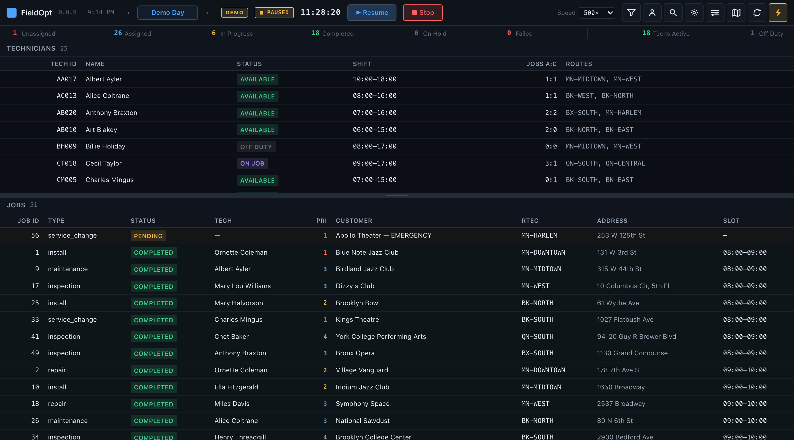
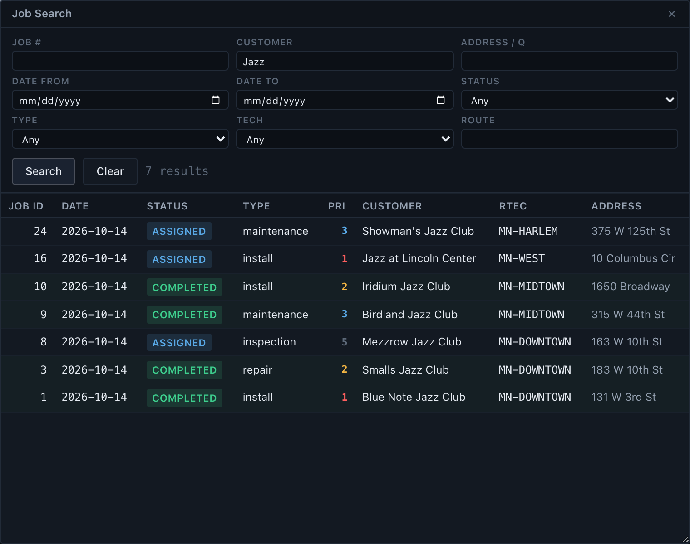
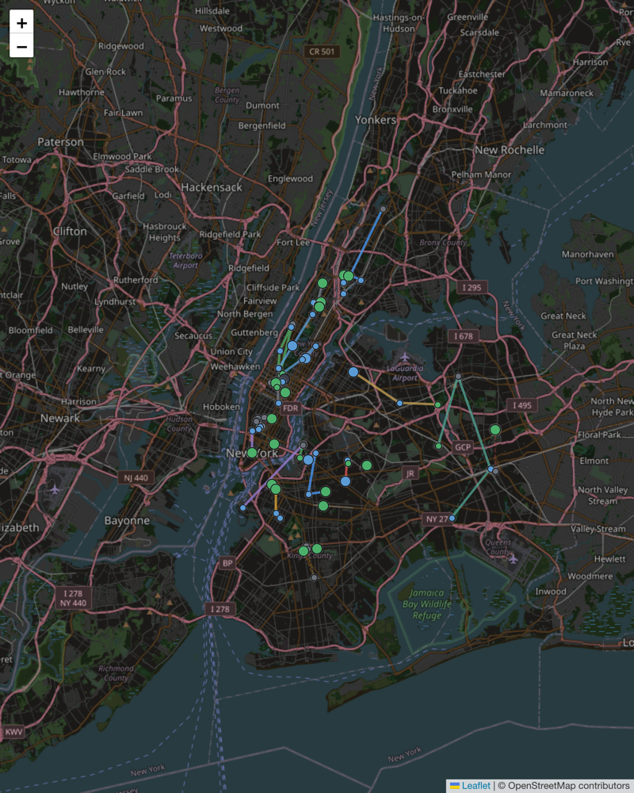
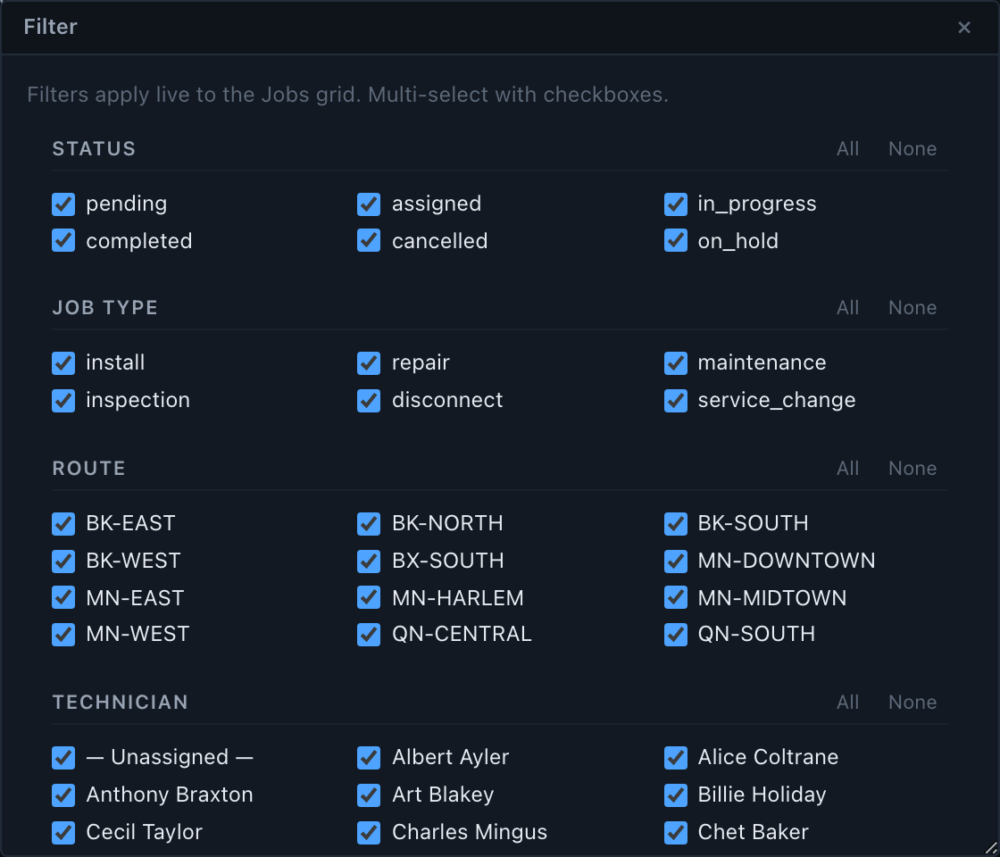
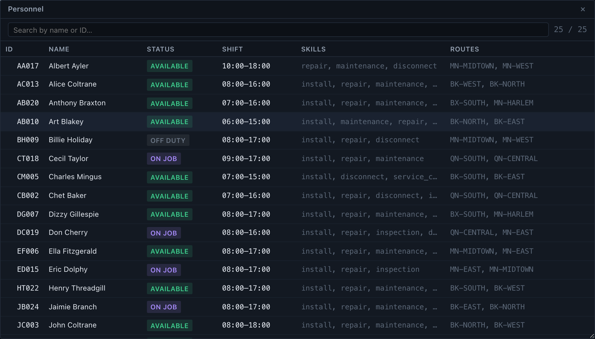

## Overview
FieldOpt - v0.0.9<br>
An open-source field service management system. FieldOpt is an enterprise-grade dispatch console designed for dispatchers and field service companies to efficiently assign, route, and manage service jobs across a workforce of field technicians.

<table align="center">
	<tr>
		<td colspan="2" align="center">
			<br/>
			Dispatch Console
		</td>
	</tr>
	<tr>
		<td align="center">
			<br/>
			Job Search
		</td>
		<td align="center">
			<br/>
			Map in Second Window
		</td>
	</tr>
	<tr>
	<td align="center">
			<br/>
			Route Filter Display
		</td>
		<td align="center">
			<br/>
			Personal Display
		</td>
	</tr>
</table><br>

**Auto-Router** — Automatically assigns jobs to the best qualified technicians

**Skill-Based Matching** — Ensures technicians only get jobs they're qualified for (manual override capable)

**Capacity Management** — Prevents overbooking by tracking tech workload

**Route Criteria & Management Areas** — Techs are assigned geographic zones; jobs carry route criteria for zone-aware dispatch

**Enterprise Dispatch Console** — Server-rendered HTMX split-pane layout with right-click context menus, drag-and-drop assignment, multi-select batch operations, tech timeline, day picker, floating filter/search/personnel windows, and a detachable map popup for multi-monitor setups

## Launch FieldOpt

Try it first with nothing installed: **<https://demo.fieldopt.dev>** runs the whole console in
your browser — the same SQL as a server install, on Postgres compiled to WebAssembly.

### Requirements

- Docker + Docker Compose (Mac, Linux or Windows)

Each [release](https://github.com/sys-ae/fieldopt/releases) has `fieldopt-<version>.zip` (this
self-host bundle) and `fieldopt-demo-<version>.zip` (the browser demo for offline use), or clone
the repo.

### Run

```bash
make up        # start postgres (pg_cron) + postgrest + nginx
```

No `make` (Windows)? `docker compose -p fieldopt up -d --build` does the same.

That is the whole install. A fresh database volume creates its own schema, installs the
application and loads the demo day on first boot (`deploy/initdb.sh`), so there is no
migration or seed step to run. Browse <http://localhost:8081>.

```bash
make demo      # enable the sim UI, then press Start Demo in the console
make no-demo   # disable it again
make pg-apply  # re-install the SQL after editing db/functions (dev loop)
make pg-seed   # reload the demo day
make pg-sync   # push web/ assets into nginx without an image rebuild
make down      # stop containers (DB volume kept)
make clean     # stop + wipe DB volume (next boot re-installs from scratch)
make logs      # tail nginx + postgrest + postgres
```

#### Access

| Service | URL |
|---------|-----|
| Dispatch Console | http://localhost:8081/ |
| RPC (PostgREST) | http://localhost:8081/rpc/ |

#### Architecture

| Piece | Role |
|-------|------|
| `db/functions/` | PL/pgSQL — every fragment, every write path, the routing and sim engine |
| `db/seeds/` | Demo data as SQL, dates relative to the run date |
| `db/postgrest/` | The `api` schema, the `web_anon` role and its grants |
| `web/` | Static assets only: `app.css`, `map.html`, vendored htmx/Leaflet |
| `deploy/` | Standalone `nginx.conf` + `postgrest.conf`, the three images, and `initdb.sh` |
| `demo/` | The in-browser demo: the same SQL on PGlite (WebAssembly Postgres), published to demo.fieldopt.dev |
| `db/schema/` | Table + enum DDL. The only thing that defines the schema now |

The page itself is `api.shell()` — Postgres renders the shell and the fragments inside it
in one response. nginx proxies `/` there and otherwise only serves static files; there is no
templating, no SSI, and no client-side URL mapping. Fragments and forms address `/rpc/*`
directly.

The demo clock runs on pg_cron inside the database (`db/functions/25_cron.sql`), scheduled
once a second, alongside a 04:00 UTC reseed that keeps a long-running demo box fresh.
`api.sim_tick()` is still an ordinary function, so if your Postgres lacks pg_cron — managed
instances often do — skip that file and call it from any external scheduler instead.

## Routing
### Routing Modes

- **Auto-Route** (`auto_route`) — assigns every pending job to the closest qualified tech
- **Sim dispatch** (`ml_assign`) — scores each qualified tech by travel time plus predicted job duration, preferring techs who can arrive inside the customer window

### How It Works

The routing engine evaluates multiple factors to find the best technician for each job:
1. **Skill** — Technician must have all required skills
2. **Route** — Job's route criteria must match one of the tech's assigned management areas
3. **Time** — Technician must have time available in their shift
4. **Distance** — Assigns closest qualified tech (haversine calculation)
5. **Priority** — Jobs are routed in priority order

### Job Evaluation

When assigning a job to a technician, the system evaluates three criteria and warns if any fail:
- **Skill** ✓/✕ — Does the tech have the required skills?
- **Route** ✓/✕ — Is the job in the tech's assigned management area?
- **Time** ✓/✕ — Does the tech have enough shift time remaining?
If any check fails, the dispatcher receives a warning with details but can override the assignment.

## Keyboard Shortcuts

| Key | Action |
|-----|--------|
| `R` | Refresh data |
| `/` | Open job search |
| `F` | Open display filter |
| `P` | Open personnel window |
| `D` / `S` / `C` / `H` | Done / Start / Cancel / Hold the selected jobs |
| `U` | Unassign the selected jobs |
| `Ctrl/Cmd+A` | Select all in focused grid |
| `Esc` | Clear selection, close modal / context menu |

## API

Everything is a PostgREST RPC over the `api` schema. HTML fragments return a `text/html`
domain type (send `Accept: text/html`); the rest return JSON.

```bash
curl -H 'Accept: text/html' http://localhost:8081/rpc/tech_list
curl -H 'Accept: application/json' http://localhost:8081/rpc/map_markers
curl -d 'p_job_id=1&p_tech_id=3' http://localhost:8081/rpc/assign
```

#### Read (HTML fragments)
- `tech_list()` — technician grid
- `job_table(p_status, p_job_type, p_tech_id, p_route)` — job grid, filtered
- `dash_bar()` — status counts
- `timeline(p_selected)` — per-tech SVG timeline
- `personnel_window()`, `filter_window()`, `settings_window()` — floating windows
- `search_window(p_q, p_date_from, p_date_to, p_job_id, p_tech_id, p_customer, p_status, p_job_type, p_route)`
- `tech_detail(p_tech_id)`, `job_detail(p_job_id)` — detail windows
- `sim_bar()` — simulation controls

#### Read (JSON)
- `map_markers()` — jobs, techs and route polylines for Leaflet
- `qualified_techs(p_job_id)` — techs split by skill match, for the Assign-To menu

#### Write
- `assign(p_job_id, p_tech_id, p_override)` — CanDo checks, override modal, assignment
- `unassign(p_job_id)`
- `job_action(p_job_id, p_action)` — `start` / `complete` / `hold` / `cancel`, FSM-validated
- `tech_set_status(p_tech_id, p_status)`
- `auto_route(p_target_date)` — assign all pending jobs to the closest qualified tech

#### Simulation
- `sim_start(p_speed)` — reseed, pre-route, start the virtual day
- `sim_pause()`, `sim_resume()`, `sim_stop()`, `sim_speed(p_speed)`
- `sim_tick(p_wall_seconds)` — advance the clock and run the engine; called by pg_cron every second
- `seed_demo()` — reset to a fresh demo day

#### Internals (not called by the UI)
`can_do`, `haversine`, `travel_time`, `sample_duration`, `what_if_duration`, `ml_assign`,
`dispatch_tick`, `day_beats`, `on_shift`, `slot_minutes`, `sim_now`, `sim_day_done`, `is_demo`,
`html_escape`, `py_float`, `toast`.

## Change Log

### 0.0.9 (Latest)

**Postgres as a platform.** The FastAPI/Python backend is gone; the application now lives in
the database. Postgres renders the console, PostgREST exposes it as RPC, nginx serves static
files and proxies, and pg_cron drives the simulation clock. Runtime goes from
`postgres + app (FastAPI/uvicorn)` to `postgres + postgrest + nginx`.

| Was | Now |
|---|---|
| 12 Jinja2 templates | PL/pgSQL functions returning a `text/html` domain type |
| `/api/v1/*` REST + `/htmx/*` fragments | `api.*` functions over PostgREST RPC |
| Python auto-router | `api.auto_route`, `api.can_do`, `api.haversine` |
| asyncio dispatch loop, strategy and day script | `api.dispatch_tick`, `api.ml_assign`, `api.day_beats` |
| clock singleton + asyncio loop | `api.sim_state` + `api.sim_tick`, driven by pg_cron |
| Python seed script | `api.seed_demo()` in `db/seeds/01_seed.sql`, dates relative to the run date |
| `dashboard.html` | `api.shell()` in `db/functions/30_shell.sql` |
| WebSocket event stream | dropped; the console polls fragments every 3s |

- **Verified against the old stack** — before the Python app was retired, every HTML fragment
  and JSON endpoint was diffed against it and matched, and auto-route made the same 50
  assignments (same technician, distance and travel time).
- **Duration model** — the numpy log-normal sampler could not be reproduced in SQL, so
  `api.sample_duration` is a new deterministic log-normal (hash to two uniforms, Box-Muller).
  It is checked by determinism and by its mean tracking each technician's hidden `speed_factor`.
- **Live demo with no server** — <https://demo.fieldopt.dev> runs the console on PGlite
  (Postgres compiled to WebAssembly) with the same SQL as a server install; a service worker
  stands in for nginx + PostgREST. Each visitor gets a private database and a reload is a fresh
  day. Built by `demo/build.sh` (PGlite pinned and integrity-checked) and published to GitHub
  Pages by `.github/workflows/demo.yml`. Replaces the AWS demo box.
- **One-command install** — a fresh database volume installs the schema, the app and the demo
  day on first boot (`deploy/initdb.sh`). `deploy/nginx.conf` and `deploy/postgrest.conf` are
  the same files the Docker bundle uses, ready for a no-Docker install. Console on port 8081.
- **Release downloads** — tagging a version publishes the self-host bundle and the offline
  demo as release assets (`.github/workflows/release.yml`).
- **Shift-aware dispatch** — routine work is never booked past a tech's shift end; priority-1
  work may run into overtime. At 18:00 unstarted work is cancelled but in-progress jobs finish,
  and the bar then shows DAY COMPLETE.
- **Timeline** — drawn at the pane's width, 08:00–18:00; queued jobs lay end-to-end after a
  tech's committed work instead of stacking on the scheduled time. It keeps the height it was
  dragged to across close, reopen and reload.
- **Phone and tablet** — pane tabs, card rows and bottom-sheet menus on phones (portrait and
  landscape); a tap opens a row's menu. Tablets hide low-priority columns. Windows go full
  screen on small screens, and the map opens in-app there (a pop-out window on larger ones,
  only ever one map).
- **Settings** — Theme (dark/light), Refresh and Density, saved and shown when reopened.
- **Grids** — column sort and reorder on both grids, persisted per grid.
- **Fixes** — the Auto-Route button works (it posted the wrong body and got a 422); floating
  windows keep their title bar on screen; the demo clock runs smoothly at the chosen speed;
  R, /, F and P shortcuts work with nothing selected.
- **Look** — night palette shared with fieldopt.dev, the sim bar rides the header row,
  favicon on the console, map and demo, version from `api.version()` in the header.

Older versions: [CHANGELOG.md](CHANGELOG.md).

## Contributing

If you share the belief that simplicity empowers creativity, feel free to contribute.
- Submit a Pull Request
- Bug reports and feature requests

Please ensure your code follows the existing style.

